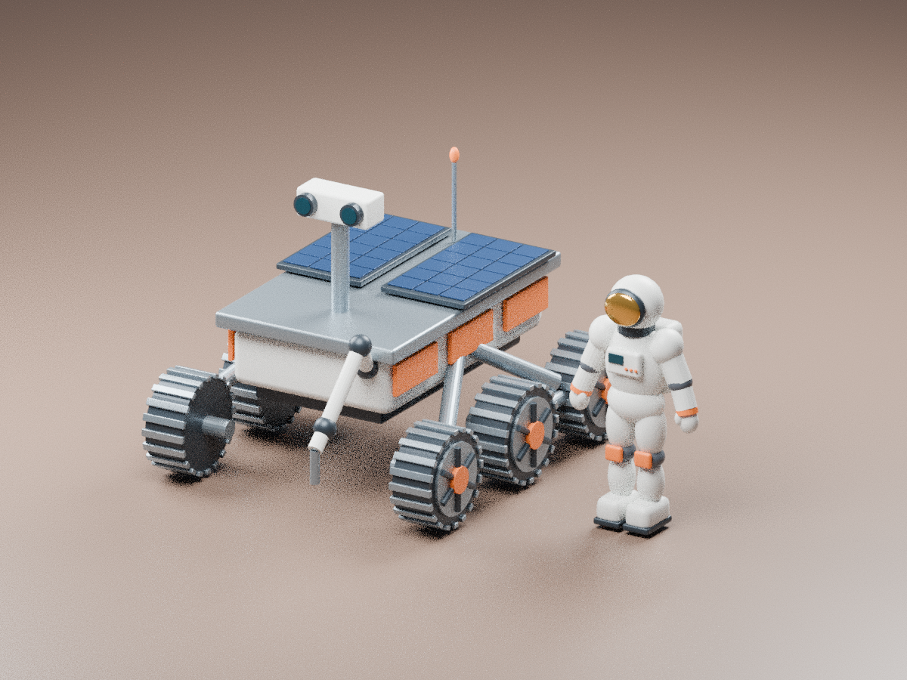

# Mars Exploration 3D

Stylized astronaut and Mars rover, each in its own file with movement animations.



## Files

| File | Animations (clip names) |
|---|---|
| `mars_astronaut_animated.blend` / `.glb` | `Walk` (3 s), `WalkLeft` (4.5 s), `WalkRight` (4.5 s) |
| `mars_rover_animated.blend` / `.glb` | `Drive` (4 s), `DriveLeft` (5.7 s), `DriveRight` (5.7 s) |

- Astronaut: legs, knees and arms swing in a walk cycle; turns are a 90° curve.
- Rover: wheels spin to match distance travelled; turns follow a 3 m radius with front/rear wheels steering in opposite directions and outer wheels spinning faster.
- Both move along −Y (forward) in Blender, 1 unit = 1 m. Movement and turning are baked into each clip as root motion.

## Three.js

```js
const gltf = await new GLTFLoader().loadAsync('mars_rover_animated.glb');
const mixer = new THREE.AnimationMixer(gltf.scene);
const clip = THREE.AnimationClip.findByName(gltf.animations, 'DriveLeft');
mixer.clipAction(clip).play();
```

To drive position and heading from your own code, remove the root track (`ASTRONAUT` / `ROVER`) from the clip.

## Blender

The three clips are NLA tracks played one after another on the timeline. Each clip starts from the origin.

## Scripts

- `scripts/build_mars.py` — builds the original models from primitives.
- `scripts/animate_separate.py` — run on the original scene with `KIND = "astronaut"` or `"rover"` to create the animated file.
- `scripts/export_glb.py` — exports the open animated file to GLB (NLA tracks → named clips). Blender exports clips at their timeline offset; shift each clip's times to start at 0 after exporting.
